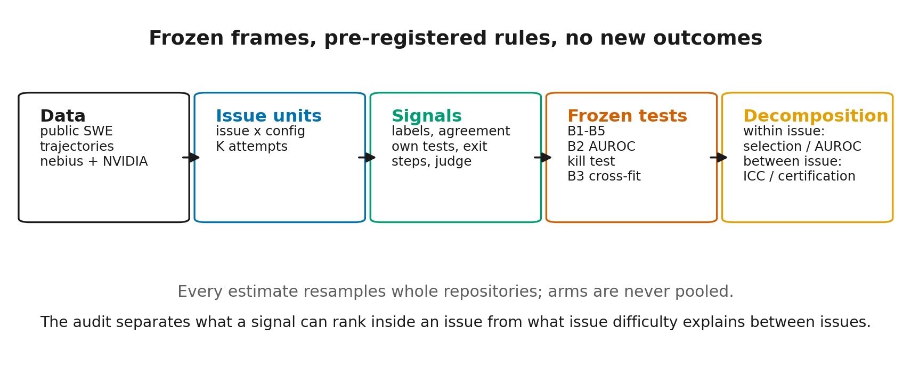

# Introduction

Software-engineering agents edit repositories, run tests, and iterate [@yang2024sweagent; @wang2024openhands]. Drawing K trajectories per issue spends more inference compute [@brown2024monkeys; @snell2024scaling]. Coverage rises; the submitted patch's resolve rate does not. That gap is selection, which deployment must solve without labels.

We audit selection on frozen trajectories with K attempts per issue. How much variance is between issues, and how flat is f(k)? Within an issue, can cheap signals rank a resolved attempt above an unresolved one? Does a local judge add information?

We contribute between-issue structure on 94,341 units over 41,073 issues from 48,300 across twelve arms (ICC, f(k), selection gap); a kill test with label-convention and no-coverage reporting; four pre-registered tests (B1 agreement lift, B2 own-test ranking, B3 cross-fit certification, B4 repeated-patch stopping) and one exploratory test (B5 own-test stopping); and a Gemma 4 judge on 4,226 pairs.

# Related work

SWE-bench defined repository-level issue resolution [@jimenez2023swebench]; SWE-agent, OpenHands and Agentless made the execution loop and repair pipelines central [@yang2024sweagent; @wang2024openhands; @xia2024agentless]. Corpora: Nebius OpenHands [@nebius2025trajectories] and NVIDIA Open-SWE-Traces [@nvidia2026traces; @ahmad2026openswe].

Repeated sampling and selective prediction are the closest work [@wang2022selfconsistency; @brown2024monkeys; @geifman2017selective]; Learn-then-Test supplies the kill test [@angelopoulos2021ltt] and LLM judges are scalable [@zheng2023judge].

# Setup

## Data and frozen frames

Nebius supplies 67,074 OpenHands trajectories over 6,306 issues and 1,823 repositories [@nebius2025trajectories]. NVIDIA supplies 818,660 rows in 32 configurations over 42,545 casefolded issues and 3,787 repositories [@nvidia2026traces]. We exclude 204 shared issues. The post-overlap, pre-floor sets are **pools**: Nebius 6,102; NVIDIA 42,198. NVIDIA's 42,341 is 42,402 frozen-config issues minus 204 shared, plus 143 non-frozen-only. Labels are the published `resolved` flags; neither harness was rerun.

The frozen analysis has eleven K=3 configurations and one Nebius K=8 arm: 94,341 units over 41,073 issues clearing the three-attempt floor (6,063 Nebius and 35,010 NVIDIA; 39 and 7,188 below K=3). The K=3 set is Nebius, four v1.0, four v1.1, and two v1.2 slices (Table 3). K=8 reuses Nebius K=3's 4,580 issues, adding none distinct. Six of eleven K=3 arms use 27B language models (four Qwen3.6, two Qwen3.8; 28B total with vision), comparable in size to Gemma 4 26B-A4B and 31B; we do not claim local execution.

{#fig:design width=100%}

## Units, rule, and signals

Each configuration-issue unit has K attempts. The submission represents the largest canonical cluster. When several clusters tie for largest, B1 chooses one by a seeded random draw over the tied clusters (as frozen in PREREG-2) and then takes that cluster's smallest `trajectory_id`; B4 breaks ties by the smallest `trajectory_id`; the kill test/`rate_loo` take the lexicographically smallest canonical cluster. Its label is the outcome. Oracle pass@K is one if any attempt resolved; `f(k)` is the plurality-cluster rate using the first k seeded draws; the gap is oracle minus selected.

Strict canonicalisation (scratch files, reordered hunks, equivalent edits) makes agreement conservative. The primary convention drops `resolved = −1`; scoring it as failure changes pool and labels. On NVIDIA, `−1` is 9.48% of SWE-rebench-V2 rows and 4.85% of Scale-SWE rows.

Five signals. Agreement is the largest canonical cluster's share. Own tests is `pred_passes_gen_tests`, null when unavailable. Exit reason is `submit` versus max-iteration. Steps is the assistant-message count; the pre-registered score is raw, and resolved attempts tend to use fewer messages (raw AUROC 0.4397; oriented 0.5603, post-hoc). Cross-fit difficulty is `rate_loo = (Σ resolved − resolved_rep)/(K−1)`, the resolve rate of the other K−1 attempts; it needs those attempts evaluated first.

The judge reads the issue and one patch and returns a single-token YES/NO judgment; `p_yes` is a two-way softmax over the YES/NO logits. Issue text is truncated to 3,072 head and 1,024 tail tokens; patches to 4,096 and 1,024.

## Inference and pre-registration

Intervals are 95% percentile bootstraps over whole repositories (B = 2,000), because attempts within an issue are dependent. B1 and B4 use Holm over the eleven K=3 configurations plus an exact sign test. B2 is a single test: SIGNIFICANT+ requires two-sided p < 0.05 and a CI excluding 0.5. B3 uses an exact sign test. K=8 is always separate and enters no family.

B5 is exploratory. Deviations are named descriptively in DEVIATIONS.md.

The kill test is fixed-sequence Learn-then-Test over a pre-registered τ grid, δ = 0.05, at least 30 calibration issues, on random-issue, held-out-repo, and temporal splits at α = 0.05, 0.10, 0.20. B1–B4 were frozen at `f9558d9` in PREREG-2. The post-freeze amendments are D9.1 (B2's frozen K=8 draw is 4,226 pairs over 754 issues, not 11,611 over 943), D9.2 (the kill test's cluster tie-break) and D9.3 (the sign-test threshold is 10–1); none changed a reported frozen result, but D9.2 means the kill test and B3 used a tie-break other than the frozen text (smallest `trajectory_id`), moving full-budget resolve by −1.83 to +1.08 pp. Descriptive tables compute no test. The judge study was frozen in its own pre-registration, under the documented Q4_0 substitution (DEVIATIONS.md), before any score existed.

# Results

## Issue difficulty dominates, and f(k) is flat

Coverage rises with K, but the selected rate does not. Pass@1 is 32.29–59.49%, plurality-cluster selected 32.20–59.44% (largest canonical cluster, ties by smallest `trajectory_id`), and oracle pass@K 41.70–64.30% (Figure 2). The selection gap is 4.82–15.75 points across K=3 and 11.24 for K=8. Point estimates only. When patches rarely coincide, the plurality-cluster rule reduces to a near-random pick, so flat f(k) restates B1's null; the informative quantity is the gap to oracle.

{#fig:gap width=95%}

f(k) is flat: across all twelve arms it moves at most 1.07 points (0.68 for K=8; Figure 3).

{#fig:curves width=95%}

ICC is 0.646–0.864 across twelve arms (Figure 4); Nebius K=8 is 0.798 (95% CI 0.787–0.811), K=3 0.795 (0.782–0.807). Most label variance is between issues; only 14–35% remains to distinguish attempts, which is why the within-issue tests are noisy.

{#fig:icc width=95%}

## Kill test: 0 BREAKS, two arms, and label sensitivity

The agreement rule produced **0 BREAKS across 189 distinct cells**. A cell is configuration × split × α × label convention. There are 99 per convention: 90 K=3 (eight configurations on three splits; three Scale-SWE on two, lacking `created_at`) plus nine K=8; the K=8 cells are identical across conventions, so 90×2 + 9 = 189. Certification was 0/12, 0/12, 2/12 at α = 0.05, 0.10, 0.20. Ten arms are NO-COVERAGE at every α (no threshold met the risk target), not a pass. Certified cells: coverage 7.14% and 5.58%; held-out risk 15.8% (11.7–20.1%) and 16.4% (12.4–20.6%).

The label convention decides the verdict. Scoring `−1` as failure raises risk to 24.0% and 27.1%, above 0.20; the pipeline certifies 0/12 arms at every α. We call neither primary. Secondary files-touched agreement is 0/11 K=3 configurations at every α; patch size and steps 0/11 at 0.20.

Cross-fit: 2/11, 10/11, 11/11 K=3 configurations vs 0/11, 0/11, 2/11 for agreement (Figure 6); K=8 certifies at all three, agreement at none. At 0.20 coverage is 27.1–63.9% and risk 4.4–15.2%. It is neither free nor blind: deploying it requires evaluating the other K−1 attempts.

## B1 and B2: agreement is tiny, own tests are weak

B1's lift is selected minus random-K, where random-K is the issue's own rate. On non-mixed issues both terms are the same label, so lift is zero by construction; the mean comes only from mixed issues. The family is 7+/4− (p = 0.549), with one negative Holm survivor: v1.1 mini/Qwen3.6 Scale-SWE, −0.755 pp [−1.207, −0.319], Holm 0.022.

B2's Nebius K=8 own-test AUROC is 0.5125 (95% CI 0.4973–0.5286, p = 0.119) on 4,226 pairs over 754 issues and 443 repositories; the CI includes 0.5, so the rule returns NOT SIGNIFICANT. Agreement is 0.5058 (0.5018–0.5112, p = 0.0020), tiny but detectable; exit reason 0.5764 (0.5578–0.5939); steps 0.4397 (0.4146–0.4649), meaning resolved attempts use fewer messages. The post-hoc oriented score is 0.5603 (0.5351–0.5854), a weak signal (|AUROC − 0.5| = 0.060).

The own-test selection lift is +0.892 pp (0.268–1.519, p = 0.005), report-only; E2 null-zero is +0.871 (0.203–1.527). E1's own-test AUROCs, on pairs where both attempts have non-null own-test results, are 0.5063 (both submitted) and 0.5066 (both max-iteration), so within-stratum discrimination is absent; the pooled 0.5125 may come from exit-reason-differing pairs. E1's stratified lifts are exploratory and uncorrected across strata: +0.67 pp (0.03–1.32) where all eight submitted (3,299 issues), +1.39 (−0.07–2.93) where exits are mixed (1,239), and +3.27 (−5.21–11.61) on 42 all-max issues. When every attempt has a test result (226 issues), the lift is −0.22 pp (95% CI −4.04 to +3.76, p = 0.977). The minimum detectable effect is about 5.6 pp at 80% power, roughly six times the pooled +0.892 pp, so this subset cannot test whether the pooled lift reflects test availability.

{#fig:auroc width=100%}

## B3: certifies, but not free and not blind

B3 compares cross-fit and agreement identically: 11–0, p <= 0.001; `−1`-as-failure also 11–0; K=8 3 vs 0. `rate_loo` needs the other K−1 labels and uses the kill test's canonical-string tie-break (DEVIATIONS.md); its headline existed before PREREG-2. It is evidence that difficulty is measurable from sibling labels, not for a free selector.

{#fig:cert width=85%}

## B4 and B5: stopping early does not buy accuracy

B4 is 8+/3− at K=3 (p = 0.227), no Holm survivor; the largest negative arm is −0.075 pp [−0.124, −0.022], raw p = 0.009, Holm 0.099, mean attempts 2.886–2.956/3. No detectable family effect. K=8 is +0.096 (0.010–0.181, p = 0.039), but an interpolation artifact: the trigger fires only when the first two patches agree, so `r_ad = f(8)`, and Δ is the corner between f(7) and f(8).

B5 stops at the first own-test pass (null never stops), else K_max = 8: 3.443/8 attempts (43%), 47.8% vs 48.0%, Δ = −0.148 (−0.980 to +0.640, p = 0.740). At matched cost there is no detectable difference; B5 is not a compute saving.

| Analysis | Estimate (95% CI) | p | Verdict |
|---|---|---|---|
| B1 | 7+/4−; one arm Holm-significant negative: −0.755 pp [−1.207, −0.319] | 0.549 (Holm 0.022) | NOT SIGNIFICANT |
| B2 | 0.5125 [0.4973, 0.5286] | 0.119 | NOT SIGNIFICANT |
| B3 | 11–0 configs; 2/10/11 vs 0/0/2 | <= 0.001 | SIGNIFICANT+ (not blind) |
| B4 | 8+/3−; largest −0.075 pp [−0.124, −0.022] | 0.227 (Holm 0.099) | NOT SIGNIFICANT |
| B5 | −0.148 pp [−0.980, +0.640] | 0.740 | NOT SIGNIFICANT (exploratory) |

: Holm over 11 K=3 configurations for B1/B4; B2 single test; B3 sign test; B5 exploratory; K=8 separate. Sources: `b1`–`b4` JSONs.

# Judge study

The judge is **Gemma 4 26B-A4B, QAT Q4_0, via llama.cpp** [@gemma2026] on two T4s. It is neither the pre-registered NF4 estimator nor the 31B model. NF4 leaves this mixture-of-experts model's 3-D expert tensors unquantised; they do not fit on two cards, so NF4 fails before scoring. A documented post-freeze deviation substituted the official QAT Q4_0 GGUF (DEVIATIONS.md); results are not comparable to NF4.

The sample is 4,226 within-issue pairs over 1,128 issues and 641 repositories, from the Nebius K=8 arm (12,917 mixed-label pairs over 1,160 issues, 1,128 sampled); the sealed first 200 are included. Pairs share an issue and have different labels, so difficulty cancels. Not B2's 4,226 own-test pairs over 754 issues: the judge takes a seeded 4,226 of 12,917 mixed-label pairs, 1,381 B2-eligible. N matches because the judge pre-registration fixed it to B2's count for comparable precision, not because samples coincide. AUROCs use `p_yes`, ties 0.5, and a repo-clustered bootstrap (B = 2,000).

The judge reaches **0.5786 (95% CI 0.5587–0.5987, p <= 0.001)**, SIGNIFICANT+. It is 2.1 points above exit reason (0.5576, 0.5451–0.5707) on the same pairs. The paired judge-minus-exit difference is +0.0209 (95% CI +0.0025 to +0.0411, p = 0.027), uncorrected and secondary: suggestive, not a corrected family result. Own tests, agreement, and oriented steps are lower (Table 2); paired judge-minus-own is +0.0594 (+0.0197 to +0.1024, p = 0.006), judge-minus-agreement +0.0665 (+0.0473 to +0.0852, p <= 0.001).

At 0.579 the judge misorders about 42% of mixed pairs, and no calibration or threshold analysis was registered. The truncation split is flat: neither patch truncated 0.5772 (0.5493–0.6059, n = 2,221); at least one truncated 0.5800 (0.5554–0.6070, n = 2,005). The realised no-truncation share is 52.6%, not the pre-registered 74% guess; a subset comparison, not causal.

The judge reads a little more than exit reason within issue, but the edge is small, uncorrected, and covers one corpus; it does not replace execution.

| Signal | AUROC (95% CI) | p | n pairs |
|---|---|---|---:|
| Judge | 0.5786 (0.5587–0.5987) | <= 0.001 | 4,226 |
| Exit reason | 0.5576 (0.5451–0.5707) | <= 0.001 | 4,226 |
| Own tests | 0.5112 (0.4913–0.5322) | 0.256 | 1,381 |
| Agreement | 0.5121 (0.5046–0.5188) | 0.0020 | 4,226 |
| Steps (oriented, post-hoc) | 0.5477 (0.5254–0.5687) | <= 0.001 | 4,226 |

: Judge frame: judge and same-pair signals; 95% repo-clustered bootstrap (B = 2,000). Steps oriented post-hoc (DEVIATIONS.md). Source: `judge_analysis.json`.

| Arm | Agent | Policy model | Benchmark | Issues |
|---|---|---|---|---:|
| Nebius K=3 | OpenHands v0.54.0 | Qwen3-Coder-480B-A35B-Instruct | SWE-rebench | 6,063 |
| v1.0 OH/M2.5 | OpenHands v0.53.0 | MiniMax-M2.5 | SWE-rebench V2 | 7,463 |
| v1.0 OH/Q3.5 | OpenHands v0.53.0 | Qwen3.5-122B-A10B | SWE-rebench V2 | 5,959 |
| v1.0 SWE/M2.5 | SWE-agent v1.0 | MiniMax-M2.5 | SWE-rebench V2 | 8,466 |
| v1.0 SWE/Q3.5 | SWE-agent v1.0 | Qwen3.5-122B-A10B | SWE-rebench V2 | 2,490 |
| v1.1 mini/Q3.6 S | mini-swe-agent | Qwen3.6-27B | Scale-SWE | 8,783 |
| v1.1 mini/Q3.6 R | mini-swe-agent | Qwen3.6-27B | SWE-rebench V2 | 12,073 |
| v1.1 SWE/Q3.6 S | SWE-agent | Qwen3.6-27B | Scale-SWE | 8,520 |
| v1.1 SWE/Q3.6 R | SWE-agent | Qwen3.6-27B | SWE-rebench V2 | 5,580 |
| v1.2 mini/Q3.8 S | mini-swe-agent | Qwen3.8-27B | Scale-SWE | 13,801 |
| v1.2 mini/Q3.8 R | mini-swe-agent | Qwen3.8-27B | SWE-rebench V2 | 10,563 |
| Nebius K=8 | OpenHands v0.54.0 | Qwen3-Coder-480B-A35B-Instruct | SWE-rebench | 4,580 |

: Frozen arms and models; counts exclude 204 shared issues. Six of eleven K=3 arms use 27B language-model policies; no local-execution claim. Source: `results/descriptive_tables.json`.

# Limitations

**Signal scope.** Signals are limited to those recorded in the trajectories. Own tests are agent-written tests (`pred_passes_gen_tests`), not the repository's held-out test suite; these corpora do not record that suite's results, so our conclusions do not cover selection by running it.

**Labels are published, not recomputed.** Flaky tests and harness errors are inherited, and identical patches can carry different labels. NVIDIA's 1–3 trajectories per issue have no stated sampling rule, so sample counts may correlate with difficulty. The `−1` labels are not missing at random (9.48% SWE-rebench V2, 4.85% Scale-SWE), and the verdict changes between conventions.

**Pre-registration/code mismatches remain.** The kill test breaks equal-size cluster ties by the smallest canonical string, not the smallest `trajectory_id` in the documented rule; the rules choose different representatives in 18.2–20.3% of K=3 issues and 8.4% of K=8 issues, and full-budget resolve moves by −1.83 to +1.08 pp. The availability test is exploratory: at 226 issues the lift is −0.22 pp (95% CI −4.04 to +3.76). The minimum detectable effect is about 5.6 pp at 80% power, roughly six times the pooled +0.892 pp, so this subset cannot test whether the pooled lift reflects test availability. B2's frame is 4,226 pairs over 754 issues, not the 11,611 over 943 implied by its table; the table counted the full pool and `gen_tests_correct`. PREREG-2's sign-test sentence says 9–2 where the exact threshold is 10–1.

**The judge is a different estimator.** It is Q4_0 via llama.cpp, not NF4 and not 31B. No bf16 or NF4 control fits, so quantisation is confounded with quality. It is pointwise, no chain of thought, and may have seen public SWE data in pre-training; contamination was not measured. Judge and own-test analyses cover one corpus (Nebius K=8); the judge-frame own-test comparison uses 1,381 pairs and the B2 frame uses 4,226. Truncation affects a substantial minority, though the exploratory split is flat.

**Inference is dependence-limited.** Pairs share attempts and issues; the repo-clustered bootstrap cannot remove that dependence. The eleven-configuration sign tests have little resolution (the exact 10–1 threshold is p = 0.0117; B1/B4 sit at 7–4 and 8–3). The 189 distinct kill-test cells are reported without family-wise control. NO-COVERAGE is not a pass; it means the test had little power. B4's K=8 result is an interpolation artifact. B5 was registered after the kill test and is exploratory.

# Implications

Sampling more does not make selection deployable with the signals these trajectories contain. Signals are weak (AUROC 0.51–0.58); own tests give a report-only +0.892 pp, but on the 226 full-availability issues −0.22 pp (−4.04 to +3.76) with a 5.6 pp MDE, roughly six times the pooled effect, so it cannot test whether the lift reflects test availability.

# References

1. Jimenez, C. E., Yang, J., Wettig, A., Yao, S., Pei, K., Press, O., and Narasimhan, K. SWE-bench: Can Language Models Resolve Real-World GitHub Issues? ICLR 2024. arXiv:2310.06770.
2. Yang, J., Jimenez, C. E., Wettig, A., Lieret, K., Yao, S., Narasimhan, K., and Press, O. SWE-agent: Agent-Computer Interfaces Enable Automated Software Engineering. NeurIPS 2024. arXiv:2405.15793.
3. Wang, X., Li, B., Song, Y., et al. OpenHands: An Open Platform for AI Software Developers as Generalist Agents. ICLR 2025. arXiv:2407.16741.
4. Xia, C. S., Deng, Y., Dunn, S., and Zhang, L. Agentless: Demystifying LLM-based Software Engineering Agents. arXiv:2407.01489, 2024.
5. Pan, J., Wang, X., Neubig, G., Jaitly, N., Ji, H., Suhr, A., and Zhang, Y. Training Software Engineering Agents and Verifiers with SWE-Gym. ICML 2025. arXiv:2412.21139.
6. Badertdinov, I., Golubev, A., Nekrashevich, M., et al. SWE-rebench: An Automated Pipeline for Task Collection and Decontaminated Evaluation of Software Engineering Agents. NeurIPS 2025. arXiv:2505.20411.
7. Wang, X., Wei, J., Schuurmans, D., et al. Self-Consistency Improves Chain of Thought Reasoning in Language Models. ICLR 2023. arXiv:2203.11171.
8. Brown, B., Juravsky, J., Ehrlich, R., et al. Large Language Monkeys: Scaling Inference Compute with Repeated Sampling. arXiv:2407.21787, 2024.
9. Snell, C., Lee, J., Xu, K., and Kumar, A. Scaling LLM Test-Time Compute Optimally can be More Effective than Scaling Model Parameters. arXiv:2408.03314, 2024.
10. Geifman, Y., and El-Yaniv, R. Selective Classification for Deep Neural Networks. arXiv:1705.08500, 2017.
11. Angelopoulos, A. N., and Bates, S. A Gentle Introduction to Conformal Prediction and Distribution-Free Uncertainty Quantification. arXiv:2107.07511, 2021.
12. Angelopoulos, A. N., Bates, S., Candès, E. J., Jordan, M. I., and Lei, L. Learn then Test: Calibrating Predictive Algorithms to Achieve Risk Control. arXiv:2110.01052, 2021.
13. Zheng, L., Chiang, W.-L., Sheng, Y., et al. Judging LLM-as-a-Judge with MT-Bench and Chatbot Arena. NeurIPS 2023 Datasets and Benchmarks. arXiv:2306.05685.
14. Gemma Team. Gemma 4 Technical Report. arXiv:2607.02770, 2026.
15. Ahmad, W. U., Ludwig, N., Majumdar, S., and Ginsburg, B. Open-SWE-Traces: Advancing Dual-Mode Multilingual Distillation for Software Engineering Agents. arXiv:2606.16038, 2026.
16. Nebius. SWE-rebench-openhands-trajectories. Hugging Face dataset, 2025. <https://huggingface.co/datasets/nebius/SWE-rebench-openhands-trajectories>
17. NVIDIA. Open-SWE-Traces. Hugging Face dataset, 2026. <https://huggingface.co/datasets/nvidia/Open-SWE-Traces>
